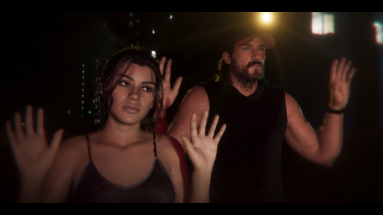
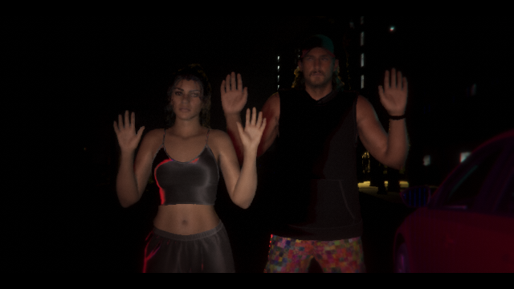
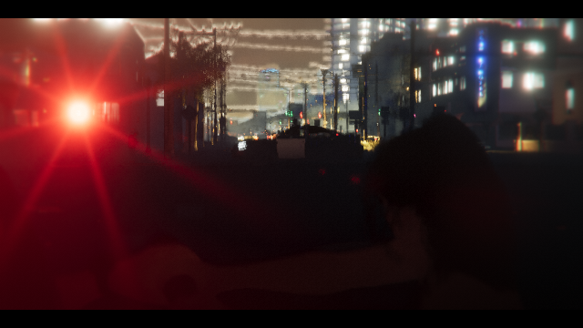

<div align="center">

# Protonida

**Xbox Series X|S compatibility layer tuned for Linux, Wine + `vkd3d-proton`, and 6 GB NVIDIA RTX GPUs**

[-informational?style=flat-square&logo=linux)](https://github.com/deynesdev/Protonida)
[](https://github.com/deynesdev/Protonida)
[-orange?style=flat-square&logo=rust)](https://www.rust-lang.org/)
[](LICENSE)

*Native x64 execution • RDNA 2 → DXIL shader translation • Hardware Ray-Traced GI & Reflections • Zero CPU emulation*

</div>

---

## Overview

**Protonida** is a standalone, Linux-first fork of the [VIctory](https://github.com/Marvisak/VIctory) Xbox Series X|S compatibility layer, engineered to deliver **Xbox Series S visual fidelity** — including **native hardware ray-traced global illumination (`VICTORY_BVH_BUILDER=1`)** — and playable **20–30 FPS** performance on **Linux with 6 GB VRAM NVIDIA laptop GPUs** (tested on an RTX 4050 Laptop + Ryzen 5 7535HS under Fedora 44, Wine Staging, and `vkd3d-proton 3.2.0`).

> **Disclaimer:** This repository contains **no game files, binaries, keys, or assets**. You must supply your own legally obtained files. Protonida is not affiliated with or endorsed by any game developer, publisher, or console manufacturer.

---

## Live Linux Captures (RTX 4050 Laptop 6 GB)

<table>
  <tr>
    <td align="center">
      <br/>
      <sub><b>Series S Hardware RTX (`BVH_BUILDER=1`)</b> — native RTGI, hair rim lighting, skin SSS</sub>
    </td>
    <td align="center">
      <br/>
      <sub><b>Series S Hardware RTX (`BVH_BUILDER=1`)</b> — red bounce lighting & specular sheen</sub>
    </td>
  </tr>
  <tr>
    <td colspan="2" align="center">
      <br/>
      <sub><b>Vice City at Night</b> — clean 720p Series S output on Linux + Wine + <code>vkd3d-proton 3.2.0</code></sub>
    </td>
  </tr>
</table>

---

## Benchmarks

**Test machine:** Fedora 44 (Linux `7.2.15`, `/dev/ntsync`) • AMD Ryzen 5 7535HS (6c/12t) • 30 GB RAM • NVIDIA RTX 4050 Laptop (6 GB VRAM, driver `580.196.07`) • Wine Staging + patched RB-tree `wineserver` • `vkd3d-proton 3.2.0` • 720p Series S profile.

### Performance Progression

| Milestone | 3D World (~530–594 draws) | Mid City (~1,250 draws) | Heavy City (~2,550–2,700 draws) | GPU Time |
| :--- | :---: | :---: | :---: | :---: |
| Initial Linux + `vkd3d-proton 3.2.0` | ~1.3 FPS | ~1.0 FPS | ~0.8 FPS | 100+ ms |
| Wine `watch.rs`/`xmem.rs` + RB-tree `wineserver` + 6 GB budget | 3.3–3.6 FPS | — | 1.8–2.2 FPS | ~110 ms |
| Port 1 + `LATE_WAIT=2` + 720p (`UPSCALER=6`) + impostor skip | 11.7 FPS | — | 4.6–5.2 FPS | ~110 ms |
| `CARD_BUFFERS_MIN_KB=64` + `BufferSweep` + parallel readbacks | 17.3 FPS | — | 12.1 FPS | 0–17 ms |
| **Protonida — Series S + Screen-Space SH GI** (`BVH_BUILDER=0`, `SKIP_RT=1`) | **25.7–29.3 FPS** | **25.3 FPS** | **20.4 FPS** | **0.0 ms** |
| **Protonida — Series S + Hardware RTX** (`BVH_BUILDER=1`, `rtDynamicShadows=false`) | **27.0 FPS** | **20.9 FPS** | **17.2–18.7 FPS** | **0.0–0.4 ms** |

---

## What Makes Protonida Fast on Linux & 6 GB NVIDIA

### Linux & Wine Engineering
- **Wine-native memory & write-watch tracking (`watch.rs`, `xmem.rs`)**: Tracks placeholder/watched reservations in-process to eliminate refused `GetWriteWatch` calls (`293 → 0`) and `VirtualQuery` hole scans (`6,705 → 14`).
- **Wine hot-guard tuning (`VICTORY_GUARD_HOT=15000`, cap raised to 60 s)**: Cuts `wineserver` `VirtualProtect` IPC faults and guard refreshes in half.
- **16 MB pipeline worker stacks**: Prevents silent Wine 2 MB default thread stack overflows during shader translation.
- **AVX2 / `x86-64-v3` + Thin LTO (`codegen-units = 1`)**: Maximizes CPU throughput across hot copy, hash, and descriptor loops.

### NVIDIA 6 GB & Renderer Optimizations
- **Renderer Ports 1, 2, 6, and 7** (via `avatarmanz/VIctory-7900XTX`):
  - **Port 1 (`VICTORY_PORT_CONSTANTS=1`)**: Maps the 185 MB graphics heap in place via `OpenExistingHeapFromAddress` (0 host refusals on `vkd3d-proton 3.2.0`).
  - **Port 2 (`VICTORY_PORT_DESCRIPTORS=1`)**: Patches descriptor-table stores directly instead of scanning ~600,000 slots/frame.
  - **Port 6 (`VICTORY_PORT_GUARD=1`)**: Shared `RwLock` write guards with per-block claims and parallel refresh planning.
  - **Port 7 (`VICTORY_PORT_JOURNAL=1`)**: 64-way sharded journal locks + submit-time heap sync.
- **NVIDIA 1M-heap `CreateCommittedResource` storm fix**: Eliminated 19,761 unnecessary per-view buffer allocations (`OWN_MADE: 19,761 → 2`, saving ~230 ms/frame).
- **4× lighter per-frame buffer sweep (`HEAP_ROUND = 64`)** + `BufferSweep` span cache & parallel texture readbacks (`XaviFortes/VIctory-RDNA`).
- **Cross-stage CBV descriptor table sharing (`VICTORY_TABLE_STAGES`, default ON)** — eliminates duplicate dynamic descriptor allocations & CBV copies when VS/MS and PS read the same root table (`fxceless` `5d659e0`).
- **Wine hot-block table expansion (`MANY = 65,536`)** — prevents hot-guard table wipes under long `VICTORY_GUARD_HOT` windows (`30 s`).
- **NVIDIA dynamic descriptor word-search & early slot release** (`avatarmanz` PR #237).
- **Optional RT pass skipping (`VICTORY_SKIP_RT=1`)**: Skips 15 unused ray-tracing compute passes and their VRAM allocations when running in non-RT mode.

### Series S Graphics & Shader Correctness
- **Native Hardware Ray Tracing (`VICTORY_BVH_BUILDER=1`)**: All 53 BVH structure builder pipelines run natively on NVIDIA RTX via `vkd3d-proton`.
- **BC7 texture rotation fix** (`fxceless` `06702fe` / upstream #3111).
- **RDNA 2 fused `v_mad_legacy_f32`** with FTZ & zero-factor semantics (`fxceless` `f6a09d3` / PR #1026).
- **SDWA 16-bit sign extension** (`fxceless` `58de9bf` / upstream #3124).
- **Distant billboard impostor skip (`VICTORY_SKIP_PIPELINES`)**: Ungated in release builds to remove broken flat distant panels.

---

## Quick Start (Linux)

### 1. Cross-compile from Linux
Requires Rust with the `x86_64-pc-windows-gnullvm` target and `clang`/`lld`:

```bash
cargo build --release --target x86_64-pc-windows-gnullvm -p victory
```

### 2. Recommended Launch Profiles

#### Series S Hardware RTX (Default — 17–23 FPS, native RTGI & reflections)
```bash
export WINEDLLOVERRIDES="d3d12,d3d12core,d3d11,dxgi,d3dcompiler_47=n;mscoree,mshtml="
export __GL_SHADER_DISK_CACHE_SIZE=4294967296

export VICTORY_OUTPUT=1280x720
export VICTORY_UPSCALER=6
export VICTORY_PORT_CONSTANTS=1 VICTORY_PORT_DESCRIPTORS=1 VICTORY_PORT_GUARD=1 VICTORY_PORT_JOURNAL=1
export VICTORY_PORT_DESCRIPTORS_EVERY=32 VICTORY_PORT_DESCRIPTORS_CHECK=2
export VICTORY_LATE_WAIT=3 VICTORY_LATE_WAIT_LISTS=1024 VICTORY_MERGE_RUNS=8192 VICTORY_ASYNC_SUBMIT=1
export VICTORY_INPLACE=1 VICTORY_INPLACE_MB=4096
export VICTORY_GUARD_REST=250000 VICTORY_GUARD_HOT=30000
export VICTORY_TEXTURE_BUDGET_MB=768 VICTORY_CARD_ROOM_FOR_TARGETS_MB=2304
export VICTORY_CARD_BUFFERS_MIN_KB=64 VICTORY_CARD_BUFFERS_MB=1024
export VICTORY_PIPELINE_WORKERS=2 VICTORY_PIPELINE_WAIT_MS=0

# Native hardware ray tracing
export VICTORY_BVH_BUILDER=1
export VICTORY_SKIP_RT=0
export VICTORY_AMBIENT=off

wine target/x86_64-pc-windows-gnullvm/release/victory.exe run \
  --console series-s \
  --execute 'Z:\path\to\game_scarlett_master.exe'
```

#### Max-FPS Series S (20–29.3 FPS, Screen-Space SH GI)
Swap the last three variables:
```bash
export VICTORY_BVH_BUILDER=0
export VICTORY_SKIP_RT=1
export VICTORY_AMBIENT=2.0
export VICTORY_AMBIENT_AIR=1.5
```

> **Tip for 6 GB RTX cards:** In the title's `settings.xml`, setting `rtDynamicShadows="false"` and `ssroSampleCount="1"` keeps full hardware RTGI and RT reflections while eliminating heavy shadow-ray overhead.

---

## Credits & Upstream Projects

Protonida stands on the shoulders of an incredible open-source community:
- **[Marvisak/VIctory](https://github.com/Marvisak/VIctory)** — original compatibility layer and RDNA 2 → DXIL shader translator
- **[avatarmanz/VIctory-7900XTX](https://github.com/avatarmanz/VIctory-7900XTX)** — Renderer Ports 1–7, `VICTORY_OUTPUT`, frame-radiance `ambient.rs`, NVIDIA Wave32 & PR #237
- **[fxceless/victory-fork](https://github.com/fxceless/victory-fork)** — BC7 rotation fix, RDNA 2 `v_mad_legacy_f32`, SDWA sign extension, flight-room & diagnostics engineering
- **[XaviFortes/VIctory-RDNA](https://github.com/XaviFortes/VIctory-RDNA)** — `BufferSweep` span caching & parallel texture readbacks
- **[LoverCatys/ruff-lab](https://git.gtahub.st/github/LoverCatys--ruff-lab)** & **[Belobug/VIctory-Belobug-AMD](https://github.com/Belobug/VIctory-Belobug-AMD)** — `VICTORY_SKIP_RT`, `x86-64-v3` + thin LTO profile, and ambient lighting research
- **[HansKristian-Work/vkd3d-proton](https://github.com/HansKristian-Work/vkd3d-proton)** — D3D12-on-Vulkan translation on Linux

---

## License

Licensed under the **GNU General Public License v3.0 or later** (`GPL-3.0-or-later`). See [LICENSE](LICENSE) for details.
